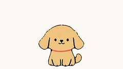
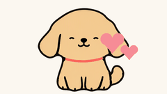
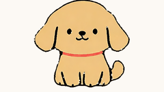
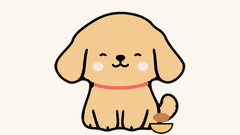
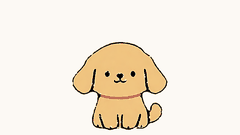
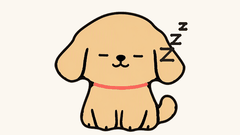

# dsh-pet 🐶（puppy 分支）

<p align="center">
  
  
  <a href="LICENSE"></a>
</p>

一只住在 [DeepSeek Harness](https://github.com/deepseek-ai/deepseek-harness) 里的桌面宠物：**圆滚滚的小金毛「小狗」（插件名 `puppy`）**。它管你叫妈妈，最爱的就是妈妈。待机呼吸、歪头张望、随机小动作（撒娇、掏骨头、哼歌、打盹）、左右转向、屏幕漫游、点击 Q 弹、拖拽甩抛反弹，51 段透明动画带着表情和道具变化随时无缝衔接（打滚、亲亲、侧趴睡、仰面睡、团成球）；还会跟随 DSH 会话事件切换工作状态动画、按档位播放余额动画、碎碎念与对话聊天、窗口失焦时弹系统通知。可多开同屏，能脱离浏览器住上**桌面**（透明置顶小窗），也能自己添加**全新宠物种类**（pet pack）。

> 本仓库是 [PC2005-cloud/dsh-pet](https://github.com/PC2005-cloud/dsh-pet) 的 fork，代码 MIT；主角换成一只金毛小狗「小狗」，名字叫 **puppy**。

## 从插件市场安装

本仓库自带一份 DSH 插件市场索引（格式 1）：[`market/index.json`](market/index.json)。

在 DSH 里打开「插件 → 插件市场 → 索引源 → 添加」，填入：

```
https://raw.githubusercontent.com/Agelei19/dsh-pet-puppy/puppy/market/index.json
```

索引里的安装源固定到某个 commit（`git+https://…#<commit>&path:/dsh-pet`），所以别人装到的是这个仓库当时的快照。
索引格式与自建索引的写法见 [market/README.md](market/README.md)。

## 说一句话就装好

在 DSH 的对话框里把下面这句发给 AI，剩下的它自己做：

```
帮我安装 https://github.com/Agelei19/dsh-pet-puppy 这个仓库里的桌宠插件 puppy，装到 desktop profile
```

它要做的事只有三步（`lib/` 已随仓库提供，**不需要构建**）：

```bash
git clone --depth 1 -b puppy https://github.com/Agelei19/dsh-pet-puppy
node dsh-pet-puppy/scripts/install-puppy.mjs --profile desktop
# 然后重启一次 DSH
```

`install-puppy.mjs` 会备份 profile 的 `package.json`、把插件写进依赖与 `dsh.profile.bundles`、在 `node_modules` 下建好链接（Windows 用 junction，避免整包复制）。加 `--dry-run` 只打印不落盘，`--profile` 换成你在用的 profile（`dsh web` 是 `web`，桌面应用是 `desktop`）。

## 快速开始（安装插件）

三种装法，任选一种：

- **对 DSH 说一句话**：见上一节。
- **插件市场**：见上一节「从插件市场安装」，加一次索引，以后点一下就装。

- **图形化（桌面应用内）**：打开「插件管理」页，在安装框里填 `dsh-pet`，不用开终端。
- **命令行**：`dsh plugin --profile <profile> add dsh-pet`，`<profile>` 按你在用的界面填——`dsh web` 填 `web`，桌面应用（Electron 版）填 `desktop`。

**不想装 DSH？** Release 里提供 Windows x64 绿色包 `dsh-pet-win-x64.zip`，解压后双击 `dsh-pet.exe` 就能跑——那是独立模式，不依赖 DSH 环境。

装完**重开 DSH**（`dsh web` 用户则重启 `dsh web`）才生效——运行中的进程持有内存里的旧插件。宠物默认落在界面右上角。

前置要求、源码安装、独立模式的用法与打包、Electron 首次下载、装完会看到什么，见 **[INSTALL.md](INSTALL.md)**。

## 插件功能

只做桌宠本身，不碰 DSH 内核；能力就下面这些。

- **51 段动画资产**：待机、走动漫游、玩耍、工作、对话等全部表现都由视频动画驱动，按权重首尾相接，也可换成自己的素材。
- **贴边收起**：静置 30 秒后自己溜到最近的屏幕边缘挂着，只露一小截；之后每隔一会儿探头探脑，四条边各有一段专属探头动作。鼠标一碰就收回来。
- **更新提示**：每天查一次插件市场索引，发现新版本就在桌面上提示一次（当前 → 最新），不打扰、不重复。
- **多开与种类**：同时养多只，各自大小与位置；也能自定义宠物种类（pet pack），一类一套动画与素材。
- **三种运行形态**：DSH web 的浏览器 overlay、DSH 桌面应用的透明置顶窗、完全不依赖 DSH 的独立模式。
- **交互与物理**：点击回应、拖拽甩抛、双击弹弓、宠物互撞，同一套物理与 Q 弹挤压手感，参数可调。
- **手机与触屏**：触屏直接拖拽甩抛，与鼠标共用同一套物理与挤压手感；手机浏览器上还能倾斜手机改变重力方向、摇一摇把宠物甩出去、碰撞时震动反馈——三项可在设置页「移动端效果」里分别关闭。传感器只在 HTTPS 或 localhost 下可用（iOS 还需点一次授权），iOS 与桌面端没有振动 API，会自动跳过。
- **碎碎念与对话**：按周期自动说一句，也能随时聊；记忆持久化、可配图、可念出来。
- **语音（说与听）**：对话回复与手动碎碎念会念出来，音色、音量与总开关可配；按住对话窗的话筒说一句，录音转成文字直接填进输入框。
- **余额展示**：内置常见服务商的余额 / 额度查询，按剩余额度分档播动画并弹气泡；也可以登记自己的服务商。
- **天气与位置**：右键「查询天气」查一次当前城市与天气（按出口 IP 粗定位 + Open-Meteo，免 key、免配置），气泡里给气温、体感、湿度、风速和对应天气图标；这份环境也会作为背景交给对话。
- **工作状态与进度播报**：跟随 DSH 会话状态切档位动画，头顶常驻一句“第几步/共几步 + 在做什么”（如 3/7 改 README.md）；干活期间每 18 秒换一句在说，任务详情与档位台词轮换，桌面上一眼看出进度。
- **待办事项**：一句话加可选到期时间，清单挂在宠物头顶；越临近到期提醒越密，由宠物说出来。
- **睡觉**：右键「睡觉」让它睡下，点一下或右键「起来」叫醒；睡着时完全安静——随机动作、碎碎念、余额、待办与工作状态都不打扰，还会按周期说梦话；睡姿可用 `animations.sleep` 配多套（蹲着睡、趴着睡…）。
- **系统通知**：任务完成或需要确认时弹系统通知，点一下回到对应会话。
- **右键菜单**：换动画、开聊、回到原位、打开 DSH / 网站、重载配置。
- **其他**：点击音效、系统托盘与每只宠物的显示位置。

各项能力的详细说明见 **[FEATURES.md](FEATURES.md)**；配置（大小 / 位置 / 多开 / 物理 / 模型 / 人设 / 宠物种类）见 **[CONFIG.md](CONFIG.md)**。

## 🔌 对外接口（供其他插件调用）

桌宠不只自己玩，也**对外开放两条调用通道**，让别的插件或脚本能驱动它、读它的状态。

- **能做什么**：让它说一句指定的话、播一段指定动画、与它对话；读它当前说的话、工作状态、系统通知、余额，以及所在城市与当前天气
- **为什么开放**：桌宠不该只是个摆设——比如一个「巡检」插件巡检验完想说句话，就能让桌宠当它的「实体」开口；也方便任何人基于它做二次开发
- **通道一 · HTTP**：挂在 DSH 自己的 Web 服务上（前缀 `/dsh-pet-7340`，只监听本机、无鉴权），跨进程、脚本可直接调。动作类接口只回 `{ok}`，数据统一从 `GET /state` 读
- **通道二 · Cordis 服务**：客户端半侧在 DSH web 页面内注册，同页客户端插件用 `ctx.get('petApi7340')` 直接取，零网络、零端口；只在该页面实例内有效，方法与返回见 [`CORDIS.md`](CORDIS.md)

相关文件（HTTP 与 Cordis 各一套）：

- [`API.md`](API.md) —— HTTP 接口一览（每个接口一句话，功能预览）
- [`openapi.yaml`](openapi.yaml) —— 完整契约（OpenAPI 3.1，可直接导入 Swagger UI / Postman）
- [`CORDIS-API.md`](CORDIS-API.md) —— Cordis 服务一览（每个成员一句话，功能预览）
- [`CORDIS.md`](CORDIS.md) —— 对外 Cordis 服务（客户端半侧，页面内 `ctx.get('petApi7340')`，不走网络）
- [`tools/api-tester.html`](tools/api-tester.html) —— HTTP 侧示例：桌宠控制台，扮演第三方消费方，可直观试用（`node tools/api-tester.cjs` 启动）
- [`tools/cordis-probe`](tools/cordis-probe/README.md) —— Cordis 侧示例：扮演同页客户端插件，用 `ctx.get()` 消费服务

## 兼容性

- **操作系统**：Windows / Linux / macOS 三端均可运行——浏览器 overlay 与桌面模式（Electron 透明置顶窗）行为完全一致；Electron 按平台自动探测/下载（`electron.exe` / `Electron.app` / linux 单文件），无需手动安装
- **无头 / 无桌面环境**：支持 Linux headless 等无图形会话——桌面模式自动检测显示环境（Linux 无 `DISPLAY` / `WAYLAND_DISPLAY` 时判定无显示、跳过桌面窗口，仅日志告警），浏览器 overlay 不受影响
- **浏览器**：浏览器 overlay 兼容 **Chromium 内核（Chrome / Edge 等）与 Firefox**——透明动画依赖 VP9-Alpha webm，三者均已实测透明确认；**不支持 Safari**（macOS 不认 webm alpha，透明渲染为黑底）——macOS 用 `.mov` 素材（GitHub Release `assets-mov`），下载放入即可（见「②.5 Safari/HEVC 兼容素材」）
- **多显示器**：支持多屏环境——跨屏漫游/抛掷以各屏工作区为界，异构缩放（各屏 DPI 不同）、任务栏条带、屏幕之间空洞均正确判定（横屏 / 竖屏 / 上下叠放皆可）；设置页「锁定在当前屏幕」可让宠物（抛掷与漫游）只在当前所在那块屏内活动

## 效果预览

全部动画（640×360，插件实际播放用的资源）。GIF 预览存放于 `dsh-pet/assets/preview/`，透明视频见 `dsh-pet/assets/webm/`（VP9 + alpha）：

**待机 / 转向**

<p>
  
  
</p>

**点击回应**

<p>
  
  
</p>

**小动作 / 玩耍**

<p>
  
  
</p>

**工作 / 睡觉**

<p>
  
  
</p>

> 注：动画为透明背景；GIF 预览中透明部分显示为页面底色，实际 webm 播放为透明。

## 从零生成你自己的宠物

AI 提示词 → 绿幕视频 → 透明动画 → 插件，换角色、换动作、换风格，全流程可复现。

完整步骤见 **[MAKE-YOUR-OWN-PET.md](MAKE-YOUR-OWN-PET.md)**（提示词配方、素材链、Safari 兼容、发布）。

## 项目结构

只列代码与发布相关目录；素材链的 video / scripts / step / pr 见 [MAKE-YOUR-OWN-PET.md](MAKE-YOUR-OWN-PET.md) 的 ② 章节（gitignore 的本地目录不列）：

```
├── README.md  INSTALL.md  FEATURES.md  MAKE-YOUR-OWN-PET.md  CONFIG.md  API.md  CORDIS.md  openapi.yaml   # 说明 / 安装 / 功能详解 / 宠物制作指南 / 配置 / HTTP 接口 / Cordis 服务 / OpenAPI 规范
├── prompts/           # ① 动画生成提示词配方（绿幕规范 + 按秒分解）
├── assets/            # 仓库展示用截图
├── tools/             # 开发工具：API 调试页、cordis-probe mock 服务商、DPI 探针
├── .github/workflows/ # CI：Safari/HEVC 转码流水线（macOS runner，手动触发 → 发布 assets-mov Release）
├── dsh-pet/           # ③ 插件（可独立 npm 发布）
│   ├── src/
│   │   ├── host/       # 宿主半侧：配置 / 路由 / 余额 / 工作状态
│   │   ├── client/     # 浏览器半侧：宠物渲染 / 动画链 / 设置页
│   │   ├── shared/     # 双端共用纯逻辑（物理 / 菜单 / 取数）
│   │   └── standalone/ # 独立模式 CLI（不依赖 DSH 直接跑桌宠）
│   ├── lib/            # 构建产物（已入库：git 直装免构建；改了 src 需重新 npm run build）
│   ├── runtime/        # 桌面模式运行壳（Electron 透明窗）
│   ├── assets/         # webm 动画 / preview GIF / 字体 / 图标 / config.jsonc 默认配置
│   └── scripts/        # 构建、发布与开发脚本
└── LICENSE             # MIT
```

## 相关项目

- **[aipets](https://github.com/kallen-noelle/aipets)** —— Windows 11 桌面宠物，五个角色可多开，透明置顶、点击穿透、甩动带惯性。特色在**动作由大模型决定**：每轮对话后模型结合时间、天气、电量与好感度挑动作，无人说话时还能排出接近一整天的编排，模型不可用时回退内置规则。聊天接任意 OpenAI 兼容接口，带长期记忆、贴纸、画图与工具调用（联网搜索 / Home Assistant / MCP），支持语音朗读与语音输入；同一套代码既有单文件 `aipets.exe` 桌面版，也有浏览器里的整页舞台版。

## 💬 反馈与发版节奏

欢迎提 [issue](https://github.com/Agelei19/dsh-pet-puppy/issues) 与 PR——bug、体验问题随时反馈。**新功能请先开 issue** 说明使用场景，确认后再动手，不要在确认前直接提交实现 PR。这个插件专注桌宠与 DSH 本身，偏离太远的需求一般不会做。动手前也请先翻一眼 [提交记录](https://github.com/Agelei19/dsh-pet-puppy/commits/puppy)，确认不是已经修掉的同款问题（有些问题可能已经在 `main` 上修好了，只是还没发版）。

- **小修不单独发版**：不影响使用的小 bug 与优化会**累计**到下一个版本一起发，避免版本更迭过于频繁。所以「`main` 上已经修了」不等于「你装的这版已经包含」——`latest` 没更新时，以 `main` 的提交记录为准。
- **想立刻用上未发布的修复**：按 [INSTALL.md](INSTALL.md) 的「从源码安装」把插件指向本地仓库即可；注意**宿主半侧**的代码改动要**重开 DSH** 才生效（浏览器半侧刷新页面即可）。
- **报 bug 时请带上**：插件版本、`dsh` 版本、操作系统、复现步骤（有日志或截图更好）。

## 许可

- **代码**：MIT，来自上游 [PC2005-cloud/dsh-pet](https://github.com/PC2005-cloud/dsh-pet)（Copyright (c) 2026 PC2005-cloud）。保留原 `LICENSE` 与署名即可自由使用、修改、再分发。
- **角色与动画**：AI 生成。主形象用 MOSS-Image 文生图后经 `scripts/` 修线上色；51 段动画用 Wan2.2 图生视频（首尾帧约束）生成，再由本仓库脚本抠像、调色、编码。提示词在 `prompts/`，可复现。
- **依赖**：`openai`、`@anthropic-ai/sdk`、`zod`、Electron 工具链均为宽松许可。可选语音朗读用 `@andresaya/edge-tts`（GPL-3.0-only），它是运行时动态 `import()` 的独立 npm 包、不内联进 `lib/`；把整包打成一个文件发行时会受 GPL 约束，那时去掉语音或按 GPL-3.0 发行。
